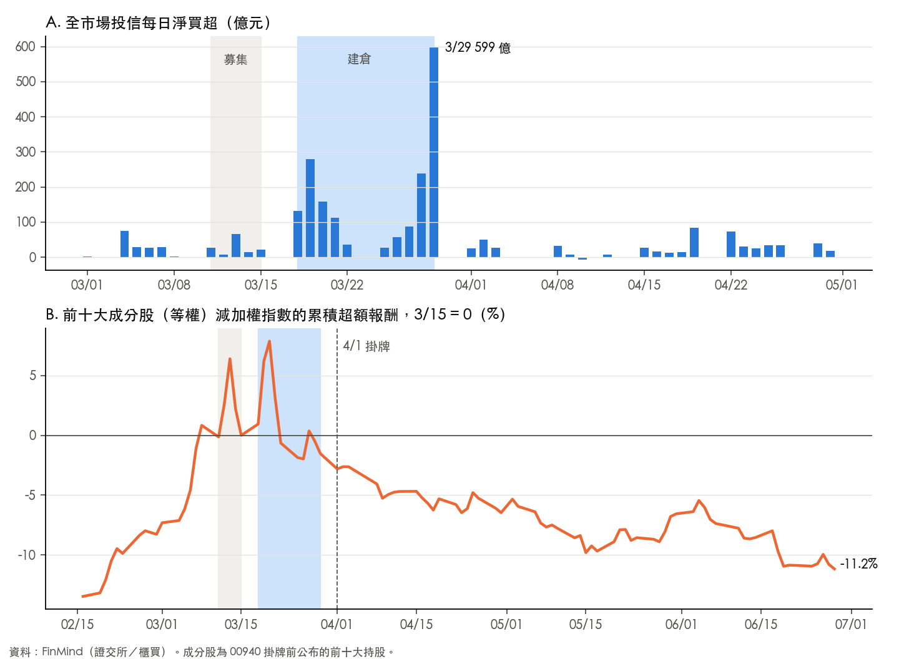

# 案例 6：00940 募集與建倉（2024-03）

> **一句話**：1,752 億的被動買盤，時間、標的、金額全部事前公開。前十大成分股在指數公布到募集前就漲了 12%；真正開始買的那 10 天，成分股反而跑輸大盤。強制買盤是被市場「賣進去」的。

| 項目 | 內容 |
|---|---|
| 接縫 | 指數規則與成分股提前公開 × 新 ETF 必須在掛牌前的固定窗口內買完 → 誰會在哪幾天買什麼，事前全部知道 |
| 強制流來源 | 新 ETF 依契約須在掛牌前把募得資金買成成分股 |
| 量級 | 1,752 億，10 個交易日內買完，日均約 175 億；前十大成分股建倉期投信佔成交量平均 15% |
| 不看價格的一方 | 元大投信（00940），必須在期限內買到 |
| 天然對手方 | 指數公布後先卡位成分股的人（散戶「坐轎」與短線資金） |
| 規則風險 | 低：建倉時程寫在公開說明書，監管只事後管行銷 |
| 查證狀態 | ✅ 時程與金額已對媒體與官方資料；價格與投信流量自行用 FinMind 重算 |

---

## 1. 發生了什麼

| 日期 | 事件 | 來源 |
|---|---|---|
| 2024-02-26 | 臺灣價值高息指數開始發布即時指數，同時公布前十大成分股（計算資料 2024-01-31）：聯電、群光、漢唐、聯發科、長榮、神基、鈊象、中美晶、新普、瑞儀 | [TIP news/289](https://www.taiwanindex.com.tw/news/289) |
| 2024-03-11 ～ 03-15 | 募集，募得 1,752 億，創台灣 ETF 成立金額紀錄 | [中央社](https://www.cna.com.tw/news/afe/202403200417.aspx) |
| 2024-03-18 | 報備成立，開始建倉 | [新頭殼](https://newtalk.tw/news/view/2024-03-23/913288) |
| 2024-03-18 ～ 03-29 | 建倉。3/29 全市場投信單日淨買 599 億，創歷史紀錄 | [新頭殼](https://newtalk.tw/news/view/2024-03-29/914160)；FinMind 重算 |
| 掛牌前 | 公布持股，長榮 9.32% 最大 | [新頭殼](https://newtalk.tw/news/view/2024-03-29/914160) |
| 2024-04-01 | 掛牌：開 9.93、收 9.76，跌破 10 元發行價；成交 134.7 萬張 | FinMind |

## 2. 機制

新 ETF 募到的錢，必須在掛牌前買成指數成分股。指數規則、成分股、募集期、掛牌日全部事前公開，所以「誰、在哪 10 天、要買哪些股票、大概多少錢」都算得出來。

可預測性這麼高的時候，搶先買的人會在公布當下就把價格推上去，然後把真正的建倉期當成出場的流動性。投信的買盤不是推升價格的力量，而是讓先上車的人下車的對手。

## 3. 關鍵數字

**流量確實到了。** 3/18 ～ 3/29 全市場投信淨買 **1,725 億**，跟募集金額 1,752 億幾乎一樣。前十大成分股在這 10 天，投信淨買平均佔個股成交量 **15%**（漢唐 21%、鈊象 20%）。

**但價格沒有跟著漲。** 前十大成分股等權重減加權指數的超額報酬（%）：

| 區間 | 平均超額 |
|---|---|
| 2/15 → 2/23（指數公布前） | +4.2 |
| 2/23 → 3/8（指數公布 → 募集前） | **+12.3** |
| 3/8 → 3/15（募集期） | −0.9 |
| 3/15 → 3/29（建倉期） | **−1.7** |
| 3/29 → 4/30（掛牌後 1 月） | −4.6 |
| 3/29 → 6/28（掛牌後 3 月） | **−11.2** |

逐檔明細見 `data/case06_table.csv`，程式在 `scripts/case06_00940.py`。

## 4. 我的解讀（草稿，待討論）

1. **公開的強制流，價格在公告時就反映完了，不是在執行時。** 最大的一段漲幅（+12.3%）落在指數公布之後、募集之前。建倉期投信佔成交量 15%，成分股卻跑輸大盤。對 prop desk 來說，可以交易的是「公告到執行之間」，以及「誰會在建倉期賣」，不是「投信會買」。
2. **跟美國指數納入的文獻對照。** Greenwood & Sammon (JF 2025) 發現 S&P 500 納入效應從 1990 年代的 7.4% 降到近十年不到 1%，原因是事件越來越好預測、套利者會搶先。00940 是同一件事的極端版：可預測性 100%，而且散戶全民搶跑。
3. **跟我自己的研究一致。** 高股息 ETF 定期換股時，納入股在「資料截止日」隔天就開始漲，到正式公告前已經漲了大半，因為名單可以用公開規則算出來。00940 首次建倉是同一個現象：規則一公開，價格就動。

## 5. 限制與未證實

- 只看了前十大（50 檔中佔比最高的 10 檔），等權重；基準是加權指數。2024-03 台積電大漲，加權指數偏強，可能高估跑輸幅度。**待做**：改用同產業非成分股當基準。
- 全市場投信買超包含同期其他基金（例如 00939 募 531 億也在建倉），1,725 億不全是 00940。
- 2/15 → 2/23 已經有 +4.2%，可能是指數公布前市場已在推估名單，也可能只是這些股票本來就強。沒有做對照組。
- 原手冊寫「3/20（週三）才開始布局」，新頭殼報導是 3/18 成立後即開始建倉，全市場投信在 3/18 已淨買 132 億。
