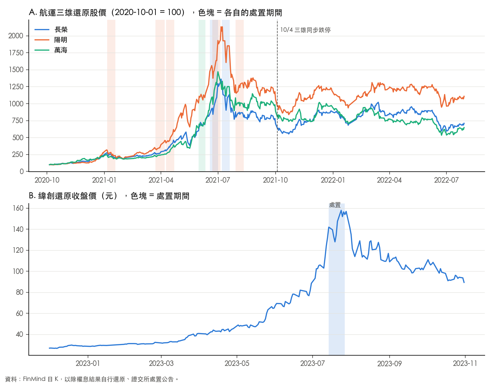

# 案例 10：航運三雄與處置制度（2021）

> **一句話**：處置制度是為了給過熱的股票降溫，但 2021 年長榮第一次處置的 10 個交易日內又漲了 52%。處置限制的是當沖，不限制隔日沖和波段買盤，在題材正熱的時候擋不住。

| 項目 | 內容 |
|---|---|
| 接縫 | 處置措施（5 分鐘撮合、大額預收款券）只增加交易摩擦 × 題材買盤不在乎摩擦，而且「處置 = 夠強」本身變成訊號 |
| 強制流來源 | 不是強制流，是規則造成的流動性變化：當沖客被擋在外面，賣壓變少 |
| 量級 | 長榮 2021-06-16 單日成交 101.6 萬張、1,422 億元 |
| 不看價格的一方 | 追題材的散戶與隔日沖 |
| 天然對手方 | 想放空但被處置限制的人；融資斷頭時的強制賣方 |
| 規則風險 | 高：2026-08 處置新制已經改了規則（見案例 19） |
| 查證狀態 | ✅ 處置期間與價量自行從證交所／FinMind 資料核對 |

---

## 1. 發生了什麼

| 日期 | 事件 | 來源 |
|---|---|---|
| 2021-03-23 ～ 04-22 | 陽明連續兩次處置，期間各漲 38%、39% | 證交所處置公告（FinMind）；自行計算 |
| 2021-05-31 ～ 06-11 | 萬海第一次處置，期間漲 20% | 同上 |
| 2021-06-16 | 長榮成交 101.6 萬張、1,422 億元 | FinMind 日 K |
| 2021-06-18 ～ 07-01 | 長榮第一次處置，期間漲 **52%** | 同上 |
| 2021-07-06 | 長榮盤中最高 233 元 | FinMind 日 K |
| 2021-07-07 ～ 07-20 | 長榮第二次處置，期間跌 16% | 同上 |
| 2021-10-04 | 三雄同步跌停（長榮 −9.7%、陽明 −10.0%、萬海 −9.8%） | FinMind 日 K |

## 2. 機制

台股的處置是「注意股」累積到一定次數後觸發：第一次處置改成約每 5 分鐘撮合一次，單筆 10 張或多筆累計 30 張以上要預收款券，為期 10 個交易日。目的是降溫，但它沒有禁止買進，只是讓交易變慢、變麻煩。

在題材正熱的時候，這反而有兩個副作用：當沖客進不來，盤中的賣壓變少；「被處置」本身變成「這檔夠強」的公開訊號。

## 3. 關鍵數字

處置第一天（D1）收盤 → 處置最後一天（DE）收盤，股價用除權息資料自行還原：

| 股票 | 處置 | 期間 | D1→DE | 最後 6 天 | 出關後 20 天 |
|---|---|---|---|---|---|
| 陽明 | 第二次 | 2021-01-05 ～ 01-18 | −25.6% | −12.8% | +17.2% |
| 陽明 | 第一次 | 2021-03-23 ～ 04-07 | +38.4% | +36.3% | +81.9% |
| 陽明 | 第二次 | 2021-04-09 ～ 04-22 | +39.4% | +31.0% | +54.0% |
| 萬海 | 第一次 | 2021-05-31 ～ 06-11 | +20.3% | +8.4% | +64.5% |
| 長榮 | 第一次 | 2021-06-18 ～ 07-01 | **+52.1%** | +53.8% | −32.2% |
| 陽明 | 第一次 | 2021-06-22 ～ 07-05 | +27.5% | +30.5% | −39.1% |
| 長榮 | 第二次 | 2021-07-07 ～ 07-20 | −16.1% | −7.4% | −25.4% |
| 陽明 | 第二次 | 2021-07-29 ～ 08-11 | −3.5% | −0.8% | −2.4% |

程式在 `scripts/case10_11_disposition.py`，明細在 `data/case10_11_disposition.csv`。

## 4. 我的解讀（草稿，待討論）

1. **處置不是煞車，而是一個公開的「強勢股名單」。** 我另外用 2020-01 ～ 2026-03 共 2,551 起處置事件做過研究（尚未公開）：處置期間股價中位數漲約 3%，七年每一年都是正的，而且漲幅集中在出關前約 6 天（市場搶出關）。航運三雄是這個規律的極端版：8 次處置裡 5 次在處置期間漲 20% 以上。
2. **處置的「位置」比處置本身重要。** 同樣是處置，3–6 月（題材還在加速）的處置之後繼續大漲；7 月以後（長榮 7/6 見高點）的處置是頂部訊號。處置規則只看過去的漲幅，不知道題材走到哪裡，所以它的時點常常落在最後一段噴出。
3. **真正終結行情的不是監管，是基本面加上融資。** 2021-10-04 的跌停起因是運價回落，加上融資斷頭的強制賣壓。處置制度在整個過程中沒有扮演關鍵角色。

## 5. 限制與未證實

- 8 次處置只是個案，不能當統計證據；大樣本結論見第 4 節第 1 點的研究。
- **原手冊勘誤**：原手冊寫處置措施是「單筆不逾 10 張、當日不逾 30 張」，實際上是單筆 10 張或多筆累計 30 張以上要**預收款券**，並沒有禁止超過。⚠️ 我依據的是證交所處置措施的一般規定，沒有逐一核對這幾次處置公告的原文。
- 原手冊寫長榮 6/16「吸金 1,415 億元」，FinMind 資料是 1,422 億元。
- 原手冊引用 PTT 網友「不能當沖可以隔日沖」與「主力為避處置刻意壓盤」的說法，屬於市場傳聞，本文不採用。
