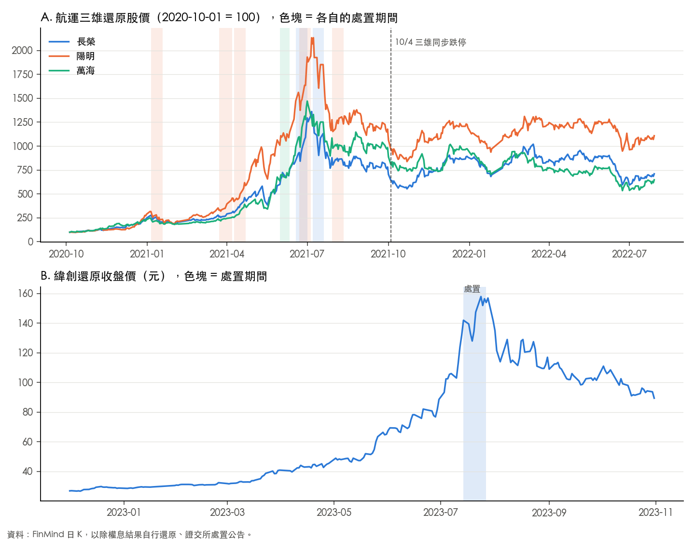

# 案例 11：緯創 2023 AI 行情與處置

> **一句話**：緯創半年從 27 元漲到 161.5 元，被處置的 10 天又漲了 8.5%，最後 6 天漲了 20%。出關隔天就是相對高點，之後 3 個月回吐約四成。

| 項目 | 內容 |
|---|---|
| 接縫 | 同案例 10：處置只增加摩擦，不擋題材買盤；出關日是公開、確定的日期 |
| 強制流來源 | 出關日前後：處置期間被擋在外的當沖與融資資金重新進場，之後獲利了結 |
| 量級 | 出關日 2023-07-28 成交 20.9 萬張 |
| 不看價格的一方 | 追 AI 題材的散戶 |
| 天然對手方 | 先上車的波段資金與主力，在出關前後出貨 |
| 規則風險 | 2026-08 處置新制縮短處置天數、加快撮合（見案例 19），出關日的行為可能改變 |
| 查證狀態 | ✅ 價格、處置期間自行核對；⚠️ 注意股觸發條件數字未核對原始公告 |

---

## 1. 發生了什麼

| 日期 | 事件 | 來源 |
|---|---|---|
| 2023-01 | 股價約 30 元起漲 | FinMind 日 K |
| 2023-07-14 ～ 07-27 | 第一次處置（10 個交易日） | 證交所處置公告（FinMind） |
| 2023-07-25 | 盤中最高 161.5 元，當時歷史新高 | FinMind 日 K |
| 2023-07-28 | 出關，收 157 元（+1.95%），成交 20.9 萬張 | FinMind 日 K |
| 2023-07-28 之後 20 個交易日 | 下跌 27.9% | 自行計算 |

## 2. 機制

和案例 10 一樣，處置沒有擋住題材買盤。比較特別的是「出關日」：處置期間是公告時就知道的固定 10 個交易日，所以出關日是事前確定的事件。處置期間當沖與部分資金被擋在外面，出關當天會集中回來。市場預期這件事，所以在出關前就先買。

## 3. 關鍵數字

| 指標 | 數值 | 來源 |
|---|---|---|
| 處置期間（D1 收盤 → DE 收盤） | +8.5% | 自行計算 |
| 處置最後 6 天 | +20.3% | 自行計算 |
| 出關後 20 個交易日 | −27.9% | 自行計算 |
| 2023-10 底收盤 | 約 89 元（從高點回落約 45%） | FinMind 日 K |

## 4. 我的解讀（草稿，待討論）

1. **緯創是「搶出關」的教科書案例。** 處置期間前半段幾乎沒動，漲幅集中在出關前最後 6 天。跟我在 2,551 起處置事件裡看到的規律一樣：漲幅集中在出關前約 6 天，出關後持平或回落。
2. **出關日是確定的時間戳，可以當事件交易。** 跟國安基金（案例 18）、ETF 建倉（案例 6）一樣，市場知道「某個日期會有一群人進場」，價格會提前反映，真正那天反而是出場點。
3. **跟案例 10 比**：航運的處置有的在題材初期、有的在末期，結果完全相反；緯創的處置剛好落在題材最熱的時候。處置的時點是規則決定的（累積漲幅），不是基本面決定的，所以它常常標記出最後一段噴出。

## 5. 限制與未證實

- 單一個案，不能當統計證據。
- 原手冊寫「因 90 個交易日收盤漲幅達 316.04% 被列注意股」，⚠️ 我沒有找到證交所注意股公告原文核對這個數字。
- 原手冊引用投顧「AI 邪惡第 5 波」的評論，以及「8 檔 AI 股融資增逾 1 萬張」，屬於媒體評論，本文不採用；融資數字可以用 FinMind 融資資料重算，尚未做。
