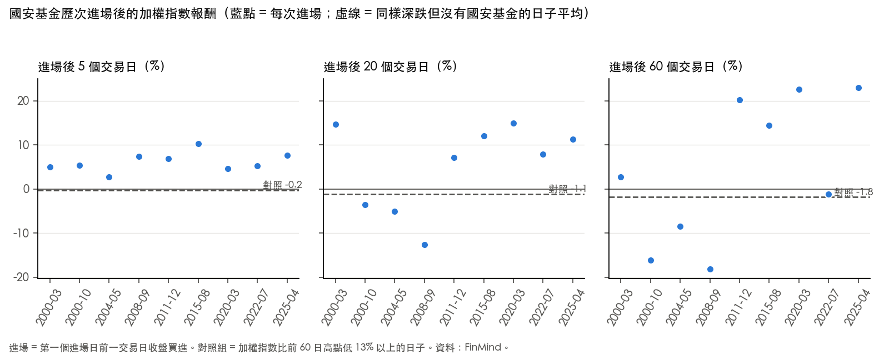

# 案例 18：國安基金歷次進場（2000–2025）

> **一句話**：國安基金 9 次進場，買在決議當天收盤、持有 5 個交易日，**9 次全賺**，平均 +6.1%。同樣深跌但沒有國安基金的日子，5 天平均 −0.2%。不過超過 20 天就看不出差別：國安基金能接住恐慌的最後一跌，但擋不住趨勢。

| 項目 | 內容 |
|---|---|
| 接縫 | 政府有一個公開、可預測的「反應函數」（跌夠深、夠急就會開會）× 市場在恐慌高點流動性最差 |
| 強制流來源 | 國家金融安定基金：法定可運用 5,000 億元（以國庫持股擔保借款 2,000 億 + 向四大基金借 3,000 億），財政部長表示實際能動用約 2,000 億；委員會決議後由公股行庫下單，買權值股 |
| 量級 | 每次 7.6 億～1,227 億元，差異很大；宣示效果大於實際買量 |
| 不看價格的一方 | 國安基金（政策目標是穩定市場，不是獲利） |
| 天然對手方 | 被追繳保證金、被迫停損的融資戶與槓桿部位 |
| 規則風險 | 低：機制運作 25 年沒變；高：何時開會是政治決定 |
| 查證狀態 | ✅ 進場日期與 2022、2025 兩次金額已對多家媒體；報酬自行計算 |

---

## 1. 發生了什麼

| 進場期間 | 投入 | 結果 | 來源 |
|---|---|---|---|
| 2000-03-16 ～ 03-20 | 542 億 | | [vocus 整理](https://vocus.cc/article/62ce200ffd897800011e63bf) |
| 2000-10-03 ～ 11-15 | 1,227 億 | | 同上 |
| 2004-05-20 ～ 06-01 | 16 億 | | 同上 |
| 2008-09-19 ～ 12-17 | 600 億 | | 同上 |
| 2011-12-20 ～ 2012-04-21 | 424 億 | | 同上 |
| 2015-08-25 ～ 2016-04-12 | 196 億 | | 同上 |
| 2020-03-19 ～ 10-12 | 7.6 億（歷來最少） | 報酬 34% | [Yahoo 財經](https://tw.finance.yahoo.com/news/%E5%9C%8B%E5%AE%89%E5%9F%BA%E9%87%91%E9%80%80%E5%A0%B4%E5%AE%89%E5%85%A8%E4%B8%8B%E8%8E%8A-%E5%89%B5%E5%8B%95%E7%94%A8%E6%9C%80%E5%B0%91%E8%B3%87%E9%87%91%E7%B4%80%E9%8C%84-003800525.html) |
| 2022-07-13 ～ 2023-04-13（護盤 275 天）| 545.08 億，其中 358.63 億買台積電 | 2023-12-25 出清，處分淨利 104.37 億 | [公視](https://news.pts.org.tw/article/632082)、[工商時報](https://ctee.com.tw/news/finance/898042.html) |
| 2025-04-09 ～ 2026-01-12（護盤 279 天，史上最長）| 122.5 億，8 檔個股 | 2026-05-06 出清，淨利 99.32 億、報酬約 81% | [ETtoday](https://finance.ettoday.net/news/3200427)、[中央社](https://www.cna.com.tw/news/afe/202608060036.aspx) |

2025 年那次同時搭配金管會 2025-04-06（週日）宣布的暫時性放空限制。

## 2. 機制

國安基金不是被規則逼著買，而是一個**事前大致可以預期**的政策反應：大盤從高點急跌 15–30%、而且有明確外部衝擊（選舉、金融海嘯、疫情、關稅）時，財政部召開委員會。決議通常在收盤後公布，隔天開始買。

它的作用主要是**宣示**：2020 年只花 7.6 億。真正讓市場止跌的，是空方知道「再往下有一個不在乎價格的買家」，加上恐慌時本來就稀少的流動性得到補充。

## 3. 關鍵數字

買在第一個進場日前一個交易日（≈ 決議公告日）收盤：

| 持有 | 國安基金 9 次平均 | 中位數 | 勝率 | 對照組平均 | 對照組勝率 |
|---|---|---|---|---|---|
| 5 個交易日 | **+6.1%** | +5.4% | **9/9** | −0.2% | 49% |
| 20 個交易日 | +5.2% | +7.9% | 6/9 | −1.1% | 43% |
| 60 個交易日 | +4.4% | +2.8% | 5/9 | −1.8% | 43% |

對照組 = 加權指數比前 60 日高點低 13% 以上、而且不在國安基金進場後 90 天內的交易日（586 天）。逐次明細在 `data/case18_events.csv`，程式在 `scripts/case18_stabilization_fund.py`。

## 4. 我的解讀（草稿，待討論）

1. **國安基金是「流動性提供者」，不是「趨勢扭轉者」。** 5 天全部有效，60 天勝率只有 5/9。2000-10 和 2008-09 兩次，進場後 60 天又跌了 16–18%。當下跌是基本面驅動（網路泡沫、金融海嘯），國安基金只能接住第一波的強制賣壓。
2. **時點比金額重要。** 9 次的 5 日報酬跟投入金額看不出關係：7.6 億的 2020 年和 600 億的 2008 年都是 +5～7%。市場在乎的是「政府出手」這個訊號，代表最恐慌的賣壓已經過去。
3. **因果要保守看。** 委員會挑的時間點，常常剛好是全球政策也出手的時候：2020-03 有 Fed 無限 QE，2025-04-09 有美國暫停對等關稅。國安基金可能是在挑「恐慌的頂點」，而不是自己造成反彈。這兩種解釋對交易來說結果一樣（跟著買 5 天），但對「國安基金有沒有用」的政策評估很不同。
4. **對 prop desk 的用法：** 決議日收盤買進、持有一週，是本集裡規則最清楚、樣本外記錄最長（25 年）的事件交易之一。但一年平均不到 0.4 次，只能當「事件簿」裡的一頁，不能當策略。

## 5. 限制與未證實

- **樣本只有 9 次**。5 日 t 值 8.5 看起來很強，但 9 個樣本的 t 值不穩定，而且無法排除「委員會挑時點」的選擇偏誤。
- **進場日期以第一個實際進場日為準**，不是委員會決議的時刻。2025 年有媒體寫 4/8 啟動、也有寫 4/9（ETtoday 兩種寫法都有）；我用 4/9 為第一個進場日、4/8 收盤為買點。2020 年原手冊寫 3/20，vocus 整理寫 3/19，我用 3/19。
- 2000–2015 年各次的投入金額來自 vocus 二手整理，**沒有對財政部原始公告**。2000-03 那次的報酬率（整理寫 −92.5%）明顯有誤，不採用。
- **原手冊勘誤**：原手冊寫 2025 年那次「2025/5/6 全數出清」，實際是 **2026-05-06** 出清；2026-01-12 是宣布結束護盤、開始處分持股。原手冊寫上限 3,000 億，那只是向四大基金借款的部分；法定總額是 5,000 億，另有 2,000 億的國庫持股擔保借款（[經濟日報](https://money.udn.com/money/amp/story/5607/9192103)、[今周刊](https://www.businesstoday.com.tw/article/category/183008/post/202512100045/)）。2025-12 立委提案擴大到 1 兆元，三讀與否未查證。
