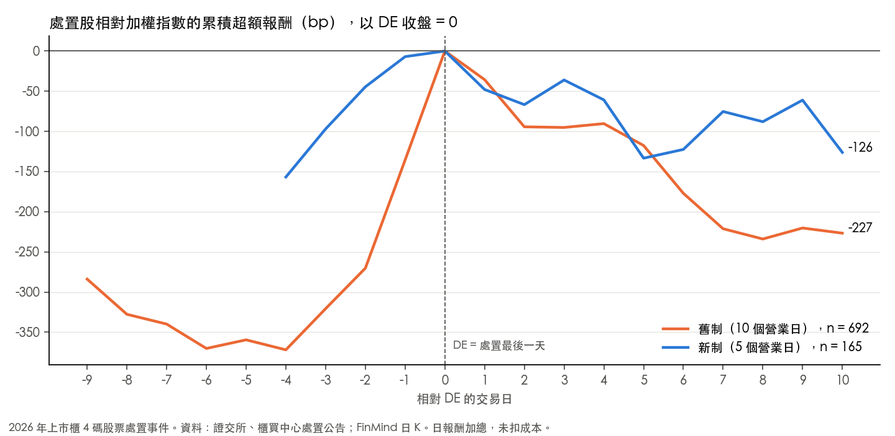

# 案例 19：台灣處置新制（2026-08-10）

> **一句話**：處置期間從 10 個營業日縮成 5 個、撮合從每 5 或 20 分鐘改成每 2 分鐘。新制上路三個月，「出關前最後兩天急拉」幾乎消失（+270 bp → +45 bp，t = 3.7），但處置期間每天的漲幅沒變，出關後一樣回落。規則改了漲幅出現的**時間**，沒改**方向**。

| 項目 | 內容 |
|---|---|
| 接縫 | 處置有固定、公開的出關日 × 處置期間交易受限 → 被擋在外的需求集中在出關前後釋放 |
| 強制流來源 | 不是強制流；是規則造成的需求延後：當沖與大額交易在處置期間受限 |
| 量級 | 2026 年上市櫃 4 碼股票處置 904 起（新制上路後 188 起） |
| 不看價格的一方 | 搶出關的短線資金 |
| 天然對手方 | 處置前已上車、在出關前後出場的資金 |
| 規則風險 | 高：新制明訂每半年檢視一次 |
| 查證狀態 | ✅ 新制內容已對證交所／櫃買公告與多家媒體；報酬自行計算 |

---

## 1. 發生了什麼

| 日期 | 事件 | 來源 |
|---|---|---|
| 2026-07 | 台股劇烈震盪，多檔股票處置期間想賣賣不掉，處置制度被批評為「流動性殺手」 | [公視](https://news.pts.org.tw/article/820617) |
| 2026-08-03 | 證交所、櫃買中心同步記者會，宣布修正處置作業要點 | [優分析](https://uanalyze.com.tw/articles/6178152718) |
| 2026-08-10 | 新制上路：第一、二次處置都改成 5 個營業日（當沖占比過高者 7 日，原 12 日）；撮合改為約每 2 分鐘一次；高價股注意標準放寬；每半年檢視 | [優分析](https://uanalyze.com.tw/articles/7221852745)、[聯合新聞網](https://udn.com/news/story/7251/9668144) |
| 2026-08-10 | 溯及既往：處置中的股票若累積天數已達新標準直接解除（例如旭然原處置到 8/17，提前到 8/10） | [優分析](https://uanalyze.com.tw/articles/1198452710) |

## 2. 機制

舊制的處置期是 10 個營業日，出關日公告時就確定。處置期間每 5 分鐘（第二次 20 分鐘）才撮合一次，大額要預收款券，當沖客幾乎進不來。結果是需求被「存起來」，市場又知道出關日，所以買盤在出關前幾天集中出現。

新制把處置期砍半、撮合變快。被延後的需求變少，存的時間也變短，出關前的集中釋放應該會減弱。

## 3. 關鍵數字

2026 年上市櫃 4 碼股票。報酬 = 個股日報酬 − 加權指數日報酬，加總，單位 bp，未扣成本。從 D1（處置第一天）收盤起算；DE = 處置最後一天。跨新舊制交替的案例排除。

| | 舊制（n = 692） | 新制（n = 165） |
|---|---|---|
| D1 → DE | +277（中位 +244） | +154（中位 +149） |
| 每天平均漂移（中位） | 27 bp | 34 bp |
| **最後 2 天 → DE** | **+270**［212, 328］ | **+45**［−59, 149］ |
| DE → 出關後 5 天 | −118 | −133 |
| DE → 出關後 10 天 | −227（中位 −517） | −126（中位 −310） |

最後 2 天的差異 226 bp，t = 3.7。舊制排除 2026-07 崩盤期間（n = 638）後，最後 2 天是 +304 bp，結論不變。

資料：證交所、櫃買中心處置公告（`scripts/case19_fetch_disposition.py`）；計算在 `scripts/case19_disposition_reform.py`，逐筆結果在 `data/case19_results.csv`。

## 4. 我的解讀（草稿，待討論）

1. **規則改的是時間分布，不是方向。** 兩種制度下處置股每天的漂移都是約 30 bp，出關後都會回落。新制只是把「出關前急拉」攤平到整個處置期。這跟我在 2020–2026 共 2,551 起處置事件裡看到的一致：處置股本身有正漂移，「搶出關」是疊在上面的時點效應。
2. **舊制最好賺的那段被規則拿走了。** 舊制下，處置期第 −4 天到 DE 的急拉約 370 bp，是最集中、最好捕捉的一段。新制下這段沒了，策略要改成「D1 進場、持有整個處置期」，每天的報酬差不多，但持有期短一半，抗成本能力變差。
3. **這是一個天然的前後對照實驗。** 新制有明確的生效日，而且同時套用到全市場，是少見可以乾淨檢驗「規則 → 價格行為」的機會。跟韓國 2026-07-29 業者自律把再平衡移出收盤競價（案例 5）一樣，都是「監管關掉一個時點接縫」的實例。
4. **對 prop desk 的意義：** 任何建立在舊制處置時程上的回測（包括我自己的），2026-08-10 以後都要重新驗證。規則有每半年檢視機制，下一次可能在 2027-02。

## 5. 限制與未證實

- **新制樣本只有 3 個月、165 起**，而且市場環境不同：舊制樣本含 2026-07 的崩盤，新制樣本是 8–11 月。排除 7 月後舊制結論不變，但沒有控制其他市場因素。
- 「每天平均漂移」用 D1→DE 除以處置天數，處置期遇到假日（新制有 6–9 個日曆營業日的案例）會有誤差。
- 日報酬加總，不是複利；個別事件有極端值（單筆 ±80% 以上），用平均和中位數一起看。
- 原手冊寫「千金股列注意股價差標準放寬（台積電條款）」；我只確認了「高價股注意標準的價差門檻有調整」，具體新門檻**未查證**。
- 原手冊提到「股期高價股跳動點 2026-07-06 改制」「現貨千金股跳動點 2027-07 改 1 元」「盤中零股 2026-12-07 提前到 9:00」，**未查證**，本文不列入。
