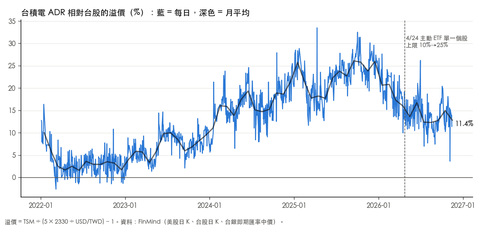

# 案例 31：台積電 ADR 溢價（2022–2026）

> **一句話**：同一家公司、同一份現金流，在紐約比在台北貴 0～30%。價差能長期存在，是因為「台股轉成 ADR」需要主管機關核准，套利的管道被關住了。不過溢價偏離近期均值之後，一個月內會回歸。

| 項目 | 內容 |
|---|---|
| 接縫 | ADR 可以自由在美國交易 × 台股普通股轉成 ADR 要經主管機關核准 → 價差只能靠單向套利收斂 |
| 強制流來源 | 只能持有美股的投資人與追蹤美國指數的被動基金，只能買 ADR |
| 量級 | 溢價年平均：2022 年 3.4%、2023 年 7.2%、2024 年 16.5%、2025 年 22.6%、2026 年至 11/13 為 15.5%（自行計算） |
| 不看價格的一方 | 追蹤只納入 ADR 的指數的被動資金 |
| 天然對手方 | 能同時進出兩地的外資：多台股、空 ADR |
| 規則風險 | 中：轉換額度、外資持股限制、境內基金持股上限都由主管機關決定 |
| 查證狀態 | ✅ 溢價數字自行計算；⚠️ 轉換限制的法條細節未取得一手來源（見第 5 節） |

---

## 1. 發生了什麼

| 日期 | 事件 | 來源 |
|---|---|---|
| 2022 Q4 | 溢價平均 2.8%，接近零 | 自行計算 |
| 2024-06 | 溢價創 15 年新高，「多台股、空 ADR」的套利交易虧損 | [Bloomberg via Yahoo](https://ca.finance.yahoo.com/news/popular-arbitrage-trade-backfires-tsmc-015127717.html)、[Benzinga](https://www.benzinga.com/markets/asia/24/06/39349605/taiwan-semiconductor-arbitrage-trade-faces-challenges-as-us-stock-premium-hits-15-year-high-ai-boom) |
| 2025-12 | 月平均溢價 26.0% | 自行計算 |
| 2026-01～04 | 溢價一路降到 16.0%（月平均） | 自行計算 |
| 2026-04 底 | 金管會把境內股票型基金／主動式 ETF 投資單一權值股的上限從 10% 放寬到 25% | [Whalesbook](https://www.whalesbook.com/news/English/technology/TSMC-Local-Rally-Shrinks-ADR-Premium-as-Regulators-Open-Doors/6a1cf623cc8b4288bbd01f29)（二手來源） |
| 2026-05 | 月平均溢價 13.6% | 自行計算 |

## 2. 機制

1 股 ADR = 5 股台股。照理說換算匯率後價格應該一樣。如果 ADR 比較貴，套利者應該「買台股、包成 ADR、在美國賣」，把價差拉平。但台股轉成 ADR 需要主管機關核准，ADR 的供給大致固定。反方向（ADR 轉回台股）沒有這個限制，所以價差只會往「ADR 比較貴」那邊偏。

需求面：有些美國投資人不能或不想開台股帳戶，有些指數只納入 ADR，被動資金只能買 ADR（[Goldman Sachs 分析，Yahoo](https://ca.finance.yahoo.com/news/trading-tsmc-adr-premium-goldman-011005457.html)）。

## 3. 關鍵數字

| 指標 | 數值 | 來源 |
|---|---|---|
| 2022 平均溢價 | 3.4% | 自行計算 |
| 2024-01～03 最高 | 23.8% | 自行計算 |
| 2025-12 月平均 | 26.0% | 自行計算 |
| 2026-05 月平均 | 13.6% | 自行計算 |
| 溢價偏離 60 日均值 vs 未來 20 日溢價變化，相關係數 | −0.41（不重疊樣本 −0.42，n = 53） | 自行計算 |
| 溢價比均值高 3 個百分點以上 → 未來 20 日溢價變化 | 平均 −2.2 個百分點（n = 191） | 自行計算 |

計算方式：溢價 = TSM 收盤 ÷（5 × 2330 收盤 ÷ 美元兌台幣即期中價）− 1。回歸分析用的是台股**下一個交易日**的收盤價，因為台股收盤比美股早半天，美國的消息台股要隔天才反映。用同一天的價格會高估回歸速度。程式在 `scripts/case31_tsm_adr.py`。

## 4. 我的解讀（草稿，待討論）

1. **溢價的「水位」是制度決定的，「波動」才是可以交易的。** 溢價能從 3% 升到 26% 又降回 13%，代表沒有套利力量把它釘在某個值。但它偏離近 60 日均值以後，一個月內大約會回歸一半。可以交易的是偏離，不是水位。
2. **回歸主要發生在 ADR 那邊。** 溢價偏高時，接下來 20 天 ADR 平均只漲 0.7%（平常 2.7%），台股則是正常漲。美國的情緒過熱會自己退燒，台股不用追上去。
3. **原手冊把 2026 年的壓縮歸因於金管會 4 月放寬持股上限，時間對不上。** 溢價從 2026-01 就開始降（26%→21%→17%），比放寬早了三個月。放寬可能讓壓縮加速，但不是起因。比較可能的是台股散戶與主動式 ETF 從年初就大量追台積電。
4. **跟本集的共通點：** 跟 GBTC（案例 4）一樣，都是「套利管道被規則關住」。差別在 GBTC 有一個明確的開閘日（轉 ETF），溢價就收斂到 0；台積電 ADR 沒有開閘日，所以只能交易均值回歸，不能交易收斂。

## 5. 限制與未證實

- **轉換限制的細節**：「台股轉 ADR 需經核准」來自 Goldman Sachs 與 Bloomberg 的報導，我沒有取得金管會或存託契約的一手條文，也不知道目前剩下多少可再發行的額度。
- **均值回歸沒有扣成本**：放空 TSM 要借券費，台股端有證交稅 0.3%，還有匯率風險。2.2 個百分點的平均回歸不等於可以實現的報酬。另外這是樣本內結果。
- **資料錯位**：圖中 2025-04-09 的 33.5% 和 2026-11 的 3.6% 是單日異常。前者是美國宣布暫停關稅當天美股大漲、台股已收盤；後者原因未查。不影響月平均。
- **原手冊勘誤**：原手冊寫「多年來溢價逾 10%」，實際上 2022–2023 年平均只有 3–7%，2024 年起才長期高於 10%。
